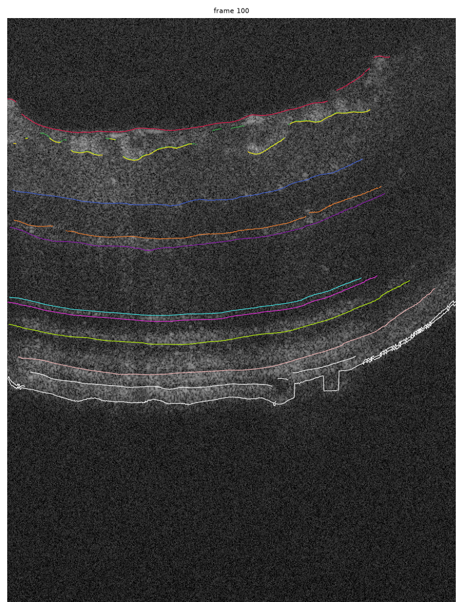
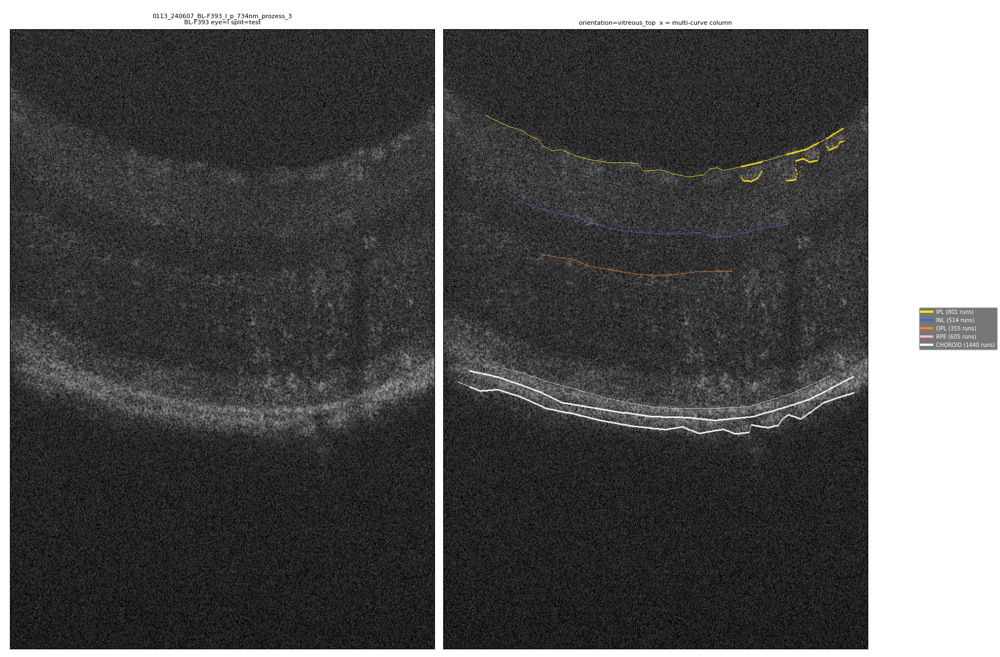
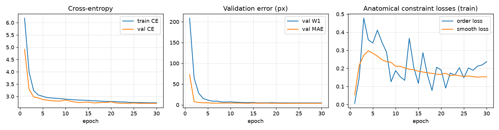
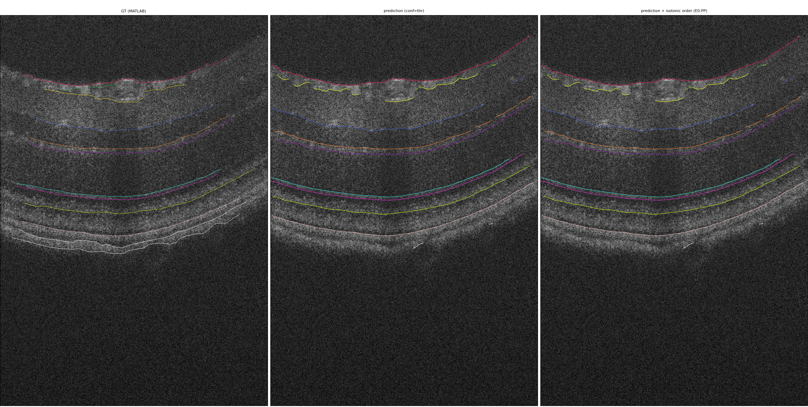
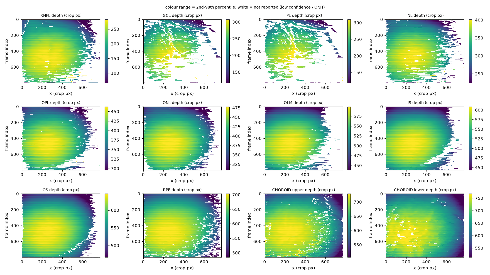
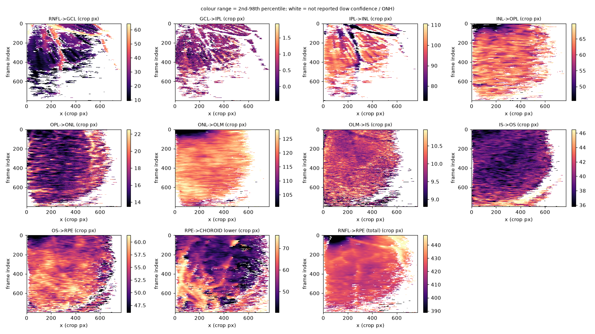

# Mouse Retinal OCT Layer Boundary Segmentation

Automatic localisation of 11 retinal layer boundaries in mouse OCT B-scans. The trained model is also applied frame by frame to the raw OCT volumes (AVI), producing a depth map for every boundary and thickness maps for the layers between them.



## 1. Data

- **Source:** annotations exported from MATLAB Image Labeler (`grdTruthOutput`, one `labelMask` per boundary) and the corresponding raw TIFF images.
- **Size:** 719 B-scans of 1143×782 px from 64 mice in 7 experimental groups (NaIO3 0/3/7 dpi, tgCR, JHA_CRX29, RPE31_32, RPE34).
- **Split by animal:** all images of one animal belong to exactly one set, so neighbouring slices of the same eye never appear in both training and evaluation.

  | | images | animals |
  |---|---|---|
  | train | 546 | 35 |
  | val | 88 | 15 |
  | test | 85 | 14 |

- **Sparse annotations:** not every image has all 11 boundaries (GCL, for example, is annotated in only 167 images), and a boundary is often annotated over only part of the width. Columns without an annotation are excluded from the loss; they are never treated as "this boundary is absent".
- **Duplicates:** identical image/annotation copies stored in several folders are kept once; draft files without any valid annotation are skipped.



## 2. Layer rules

### 2.1 The 11 boundaries and their order

In array coordinates (y pointing down) the vitreous is at the top of the image. From top to bottom the boundary order is fixed:

```
RNFL → GCL → IPL → INL → OPL → ONL → OLM → IS → OS → RPE → CHOROID
```

Each name marks the **upper boundary of that layer, on the vitreous side**. For example, "IPL" is the GCL/IPL interface and "INL" is the IPL/INL interface.

This order is not assumed by hand; it is derived from the training annotations:

- across millions of columns in which two boundaries are both annotated, the order is **never reversed**;
- the mean gaps between neighbouring boundaries match mouse retinal layer thicknesses, e.g. IPL→INL ≈ 90 px, INL→OPL ≈ 60 px, OPL→ONL ≈ 15 px, ONL→OLM ≈ 110 px.

The full statistics are in [`results/data/order_table.csv`](results/data/order_table.csv).

### 2.2 Anatomical rules used during training

1. **Order constraint:** for every pair of boundaries (a, b) where a lies above b, the prediction must satisfy `y_a ≤ y_b`. Violations are penalised with `relu(y_a − y_b)`.
   - Two boundaries are **allowed to touch** (a layer can become very thin or vanish in pathological regions); only crossing is penalised.
   - 45 pairs are constrained. Each pair needs at least 200 jointly annotated training columns and a reversal rate ≤ 1%.
2. **Smoothness constraint:** a Huber penalty on the second difference between neighbouring columns of each boundary suppresses zig-zags and sudden jumps.
3. **Confidence gating:** both constraints are applied only in columns where the model is **confident**, i.e. more than 0.7 of the probability mass lies within ±5 px of the predicted peak. If a layer genuinely disappears (pathology, near the optic nerve head) the predicted distribution there becomes flat, the constraints switch off, and the model is not forced to draw a line that does not exist.
4. **CHOROID:** 82% of the annotated CHOROID columns contain two lines (upper and lower border of the choroid). Its target is therefore bimodal, and it is excluded from the order and smoothness constraints. At inference the two highest peaks are taken as the upper and lower curve.

## 3. Model and training

**Model:** FFC-UNet, about 13M parameters. A 5-level residual U-Net whose deeper stages (from level 3 on) and bottleneck use Fast Fourier Convolution; the spectral branch gives an image-wide receptive field. GroupNorm is used for normalisation. The network outputs 11 channels, and each channel is passed through a **softmax along y in every column**, giving the position distribution of that boundary in that column.

**Targets:** each annotated boundary is converted into a Gaussian soft label along the column (σ = 1.5 px). When several consecutive pixels in one column are annotated, the Gaussian is widened accordingly.

**Loss:**

```
L = CE(column-wise soft labels)  +  λ_order · L_order  +  λ_smooth · L_smooth
λ_order = 0.1,  λ_smooth = 0.01
```

The two constraint terms are switched on from epoch 3 and ramped up linearly to their full weight over 3 epochs.

**Decoding:** a local soft-argmax (probability-weighted mean within ±5 px of the most likely position in each column), giving sub-pixel boundary positions.

**Training setup:**

| Item | Setting |
|---|---|
| Epochs | 30 |
| Batch size | 16 (4 images per forward pass, 4 accumulation steps; equivalent to a true batch of 16 because of GroupNorm) |
| Optimiser | AdamW, lr 3e-4, weight decay 1e-4, gradient clipping 1.0 |
| Learning-rate schedule | linear warm-up over the first 5% of steps, then cosine decay |
| Precision | bf16 mixed precision (FFT in fp32) |
| Augmentation | horizontal flip; vertical shift ±40 px; gamma, contrast and brightness jitter; Gaussian noise. Geometric augmentations are applied to image and annotation together |
| Model selection | epoch with the lowest validation macro W1 |
| Hardware | 1× NVIDIA H100, about 16 min, peak memory about 17 GB |



## 4. Results

Errors are in pixels on the original 1143×782 grid. MAE is computed on columns where the ground truth has a single line; CHOROID is evaluated by matching each of its two ground-truth lines to the nearest predicted peak.

| Boundary | val MAE | val median | test MAE | test median |
|---|---|---|---|---|
| RNFL | 2.00 | 1.54 | 2.15 | 1.58 |
| GCL | 3.46 | 1.69 | 3.13 | 1.87 |
| IPL | 4.58 | 2.47 | 4.70 | 2.45 |
| INL | 3.17 | 2.19 | 3.38 | 2.55 |
| OPL | 2.47 | 1.93 | 2.68 | 1.93 |
| ONL | 2.62 | 1.97 | 2.66 | 2.13 |
| OLM | 2.73 | 1.36 | 2.17 | 1.35 |
| IS | 1.97 | 1.27 | 1.66 | 1.19 |
| OS | 2.56 | 1.55 | 4.24 | 1.81 |
| RPE | 1.75 | 1.41 | 5.33 | 1.49 |
| CHOROID (two lines) | 4.00 | 2.01 | 7.00 | 2.17 |
| **Mean (without CHOROID)** | **2.73** | | **3.21** | |

- For most boundaries the median error is between 1.2 and 2.5 px, and the predicted boundaries are continuous with practically no jumps.
- The means are driven by a few difficult images. On the test set, for example, RPE has a median of 1.49 px and a P90 of 4.5 px, but its P99 reaches about 96 px: in a few images a whole stretch of the boundary is placed on a neighbouring structure.
- IPL is the hardest boundary: it lies only about 13 px below GCL, and GCL is rarely annotated.
- Results per experimental group are in [`results/metrics/`](results/metrics/).



## 5. Application to raw OCT volumes (AVI)

1. **Geometry:** the training TIFFs are direct crops of single AVI frames. For the test animal MA-N978 the TIFF corresponds to frame 59 with NCC = 1.000, scale 1.0 and no flip, so the model can be applied to AVI frames without any resampling.
2. **Crop:** every frame is cropped to (x=30, y=26, 770×1000) to remove the artefacts at the top and the black margin on the left.
3. **Inference:** every second frame is processed. Stacking the boundaries of all frames gives a depth map per boundary and thickness maps between neighbouring boundaries. The vertical axis of these maps is the frame index, not a calibrated distance.





Notes:
- Near the optic nerve head the layers are interrupted; predictions there do not indicate pathology. This region can be excluded with `07_avi_infer.py --onh`.
- GCL/IPL are fragmented on the AVI frames, and where the signal is weak the lower CHOROID border occasionally jumps between the two peaks.

## 6. Reproduction

All paths are set in `slurm/env.sh` (Capella, GPU) and `slurm/barnard_env.sh` (Barnard, CPU).

```bash
# 1) Build the dataset from the MATLAB annotations and split by animal (CPU)
python 02_prepare.py --mat-root "$MAT_BASE" --out "$DATA" --split-mode animal --workers 8
python 03_review_overlays.py --data-dir "$DATA" --out ~/octb_review --n 20      # check annotation overlays

# 2) Train (GPU, Capella)
sbatch --export=ALL,EXP=E1,MICRO=4 slurm/train.sh

# 3) Evaluation and error analysis (CPU)
python 05_evaluate.py --ckpt "$RUNS/E1/best.pt" --data-dir "$DATA" --split val --out "$RUNS/E1/eval_val"
python 08_analyze.py  --data-dir "$DATA" --models E1="$RUNS/E1/best.pt" --split test --out "$RUNS/analysis_test"

# 4) AVI
python list_avi.py --split test                                   # AVIs of test animals and their TIFFs
python 06_avi_match.py --avi "$AVI" --tiff "$TIF" --data-dir "$DATA" --out match.json
python 07_avi_infer.py --avi "$AVI" --ckpt "$RUNS/E1/best.pt" --data-dir "$DATA" --match match.json --out avi_out --step 2

# 5) Collect results into results/
python make_report_assets.py --avi-name <AVI file name without .avi>
```

The trained weights are in `results/model/E1_weights.pt` (fp16, weights only). They can be passed directly as `--ckpt` to `05_evaluate.py` and `07_avi_infer.py`. If the dataset was built in a different run, a manifest-mismatch warning is printed; it can be ignored.

Requirements: Python 3.11, PyTorch ≥ 2.1, numpy, scipy, matplotlib, Pillow, tifffile, opencv-python-headless.

## 7. Repository structure

```
02_prepare.py          MATLAB annotations → dataset; split by animal; boundary order statistics
03_review_overlays.py  annotation overlays
04_train.py            training (CE + order constraint + smoothness constraint)
05_evaluate.py         evaluation: W1, MAE, crossing rate, jump rate, per-animal results
06_avi_match.py        find the AVI frame, scale and flip that correspond to a TIFF
07_avi_infer.py        frame-by-frame AVI inference, depth and thickness maps
08_analyze.py          error analysis: two-line CHOROID evaluation, per-group statistics, worst images
list_avi.py            list AVIs and the split of their animal
make_report_assets.py  collect results into results/
octb/                  data loading, soft targets, model, losses, metrics
slurm/                 job scripts
tests/                 end-to-end test on synthetic data (bash tests/smoke_test.sh)
results/               figures, metric tables, training records, model weights
```
